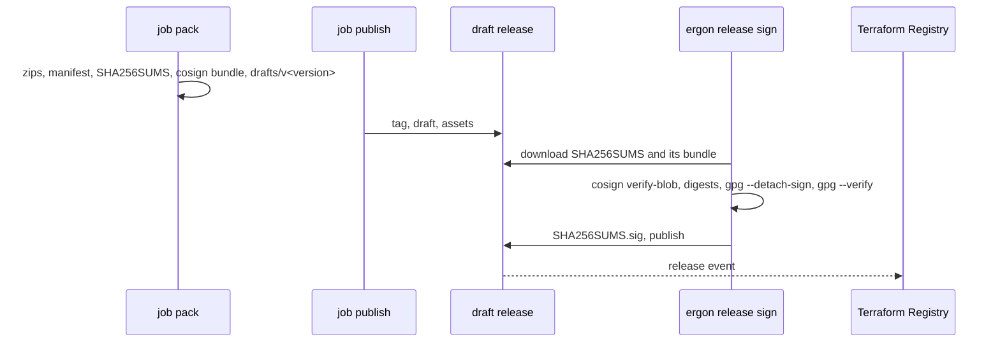

<!--
  ~ Copyright Dokimasia B.V. 2026
  ~ SPDX-License-Identifier: MIT
-->

# RFC-0012: Providers of the Terraform Registry

## Summary

A command of `go.binaries` with `registry: terraform` is a provider of the Terraform Registry. The release of each version contains a zip archive for each platform with the binary `<name>_v<version>`, the manifest `<name>_<version>_manifest.json`, and `<name>_<version>_SHA256SUMS`, as the Registry requires. cosign signs `SHA256SUMS` in the job `pack`, and `ergon release publish` leaves the release as a draft. A maintainer then runs `ergon release sign` on a workstation. The command checks the draft against the cosign signature of the release workflow and signs `SHA256SUMS` with the GPG key of the maintainer. It then uploads the signature and publishes the draft. The private key never leaves the smart card of the maintainer, and no job of a workflow has a signing key.

## Motivation

The Terraform Registry publishes a provider from the GitHub Releases of its repository. Its publishing guide lists the assets of a release:

- "The binary name is `terraform-provider-{NAME}_v{VERSION}`", and "The archive name is `terraform-provider-{NAME}_{VERSION}_{OS}_{ARCH}.zip`."
- A file `terraform-provider-{NAME}_{VERSION}_manifest.json` with the manifest of the Registry.
- A file `terraform-provider-{NAME}_{VERSION}_SHA256SUMS`, "which contains a SHA-256 checksum for each zip file and the manifest file in the release".
- A file `terraform-provider-{NAME}_{VERSION}_SHA256SUMS.sig`, "a valid GPG binary (not ASCII armored) signature".
- "Release is finalized (not a private draft)."

The guide also requires a public repository named `terraform-provider-{NAME}` in lowercase, and a tag `v` followed by a semantic version. It accepts a GPG key of the type RSA or DSA: "The Terraform Registry API accepts both RSA and DSA keys, but not the default ECC type." The Registry creates a webhook for the release events of the repository, and ingests each version that a release publishes.

ergon 0.16.0 renders a different release for a command of `go.binaries`: tar.gz archives, a binary without the suffix `_v<version>`, `checksums.txt`, a cosign bundle, and no manifest. The overlay `.ergon/local/.goreleaser.yaml` merges maps, appends to lists and replaces every other value. It adds entries, and it cannot change the managed archive or binary. `ergon release pack` attaches six types of artifacts of GoReleaser.

RFC-0007 puts GPG signatures out of scope, because the cosign signature of `checksums.txt` covers the binaries that a user downloads from GitHub Releases. Terraform installs a provider from the Registry, and the guide states: "All provider releases are required to be signed, thus you must provide HashiCorp with the public key for the GPG keypair that you will be signing releases with."

HashiCorp's scaffolding of a provider signs in its release workflow. The workflow imports the private key from the secret `GPG_PRIVATE_KEY` and its passphrase from the secret `PASSPHRASE`, so each run of the job has the key, and the secret keeps the key after the run ends. The guide also describes a release without a key in CI: "remove the signature step from GoReleaser and sign it prior to moving the GitHub release from draft to published."

## Detailed design

### Components

| Component | Where | Responsibility |
|---|---|---|
| Command option | `lang/go/baseline` | The key `registry` of a command of `go.binaries`, its rules, and the package `.` of a command |
| GoReleaser configuration | `lang/go/baseline` | The zips, the binary, the manifest, `SHA256SUMS` and the draft of a provider |
| Drafts of a pack | `core/language` | `DraftsDir`: the tags whose release remains a draft after the publish |
| Go packer | `lang/go/release` | The extra files of the checksums as assets, and the draft of a configuration whose release is a draft |
| Publish | `service/release` | `Releaser.Draft`: the tag, the draft and its assets, without the publish |
| Drafts on GitHub | `service/forge` | The drafts of a repository, the identifier of an asset, and its download |
| Sign | `service/release`, `internal/cli` | `ergon release sign`: the checks of a draft, the GPG signature of `SHA256SUMS`, its upload and the publish |



### The option

```yaml
go:
  binaries:
    - name: terraform-provider-demo
      module: .
      main: .
      description: The provider of the demo API
      registry: terraform
```

```go
// Package baseline (lang/go/baseline).

// Registry is a registry that publishes the releases of a command from the GitHub Releases of its
// repository.
type Registry string

// RegistryTerraform is the Terraform Registry, which publishes a provider of Terraform.
const RegistryTerraform Registry = "terraform"

type Command struct {
	// The other fields are unchanged.

	// Registry is the registry that publishes the releases of the command, or empty for none.
	Registry Registry `yaml:"registry"`
}
```

`Command.Validate` refuses a registry other than `terraform`. For `terraform` it refuses:

- a name without the prefix `terraform-provider-`
- a module other than `.`, because the Registry reads the tags `v<version>`, which are the tags of the root module
- packages, a cask and completions, because Terraform installs a provider from the Registry, and a person does not run a provider as a command

`Options.Validate` refuses a provider beside another command of the root module, because one GoReleaser configuration writes the checksums and the draft of the whole module. `Producer.Files` refuses a provider whose name is not the name of the repository, with an error that wraps `option.ErrInvalid`, because the Registry finds a provider by the name of its repository.

A command may name `.` as its package, the root package of its module. HashiCorp's scaffolding has its `main.go` at the root of the repository.

### The GoReleaser configuration

The configuration of a root module with a provider differs in these keys:

| Key | A provider | Another command |
|---|---|---|
| `builds.binary` | `<name>_v{{ .Version }}` | `<name>` |
| `archives.formats` | `[zip]` | `[tar.gz]` |
| `checksum.name_template` | `<name>_{{ .Version }}_SHA256SUMS` | `checksums.txt` |
| `checksum.ids` | The archives of the provider | None |
| `checksum.extra_files` | `terraform-registry-manifest.json` as `<name>_{{ .Version }}_manifest.json` | None |
| `source.enabled` | false | true |
| `release.draft` | true | Not set |

- The zips contain the binary, `LICENSE`, `NOTICE` and `README.md`, as every archive does.
- cosign signs `SHA256SUMS` in the job `pack`, as it signs `checksums.txt`, into `<name>_<version>_SHA256SUMS.sigstore.json`.
- syft writes the SBOM of each zip. `SHA256SUMS` lists the zips and the manifest alone, as the guide states. The attestation of the job `pack` covers the SBOMs.
- GoReleaser 2.18.2 keeps the source archive in a checksum file whatever its `ids` (the filter `ByID` of its `internal/artifact`), so the configuration of a provider has no source archive.
- UPX packs the Linux binaries of a provider, as it packs those of every command.
- The repository keeps `terraform-registry-manifest.json` at its root, with the protocol versions of the provider: `["5.0"]` for the Plugin SDK version 2, and `["6.0"]` for the Plugin Framework. GoReleaser fails without it, so nothing is published.

A probe on 2026-10-29 ran GoReleaser 2.18.2 in snapshot mode with these keys, with placeholders for cosign and syft. `goreleaser check` accepted `release.draft` beside `release.disable`. Each zip contained `terraform-provider-demo_v0.1.0` with the mode 0755, `LICENSE` and `README.md`. `SHA256SUMS` listed the two zips and the manifest, and `artifacts.json` did not list the manifest. Without the manifest, GoReleaser failed with `globbing failed for pattern terraform-registry-manifest.json`.

### Pack

```go
// Package language (core/language).

const (
	// The other directories are unchanged.

	// DraftsDir has an empty file for each tag whose release remains a draft after the publish, as
	// drafts/<tag>, until a person publishes it, such as with ergon release sign.
	DraftsDir = "drafts"
)
```

`Packer.Pack` of Go reads `checksum.extra_files` and `release.draft` of each configuration:

- It copies each extra file of the checksums into `assets/<tag>/`, under its name template with the version of the release. GoReleaser 2.18.2 adds the extra files of `checksum` to the lines of the checksum file alone (`internal/pipe/checksums/checksums.go`), and the configuration turns the release of GoReleaser off, so GoReleaser attaches no extra file.
- It writes `drafts/<tag>` for a configuration whose release is a draft.

### Publish

```go
// Package release (service/release).

// ErrDraft is the error of a releaser that cannot leave a release as a draft, such as GitReleaser.
var ErrDraft = errors.New("release: the releaser cannot leave a release as a draft")

type Releaser interface {
	// The other methods are unchanged.

	// Draft creates the tag name at commit and its release with notes and the files of assets, as
	// Release does, and leaves the release as a draft. It completes a draft that an earlier publish
	// left, and publishes nothing.
	Draft(ctx context.Context, name, commit, notes string, prerelease bool, assets []string) error
}

type Published struct {
	// The other fields are unchanged.

	// Draft reports a release that remains a draft after the publish. The JSON of the released
	// packages does not include it, as changesets/action writes them.
	Draft bool `json:"-"`
}
```

- `Publish` calls `Draft` in place of `Release` for an entry with `drafts/<tag>` in the pack directory.
- `ForgeReleaser.Draft` takes the steps of `Release` before the publish: it creates the tag, the draft and each asset that the draft lacks.
- `GitReleaser.Draft` returns `ErrDraft`, because a tag of git has no release.
- `ergon release publish` writes `released <name>@<version> as a draft for ergon release sign`.

A draft has its tag on GitHub, so the next publish plan does not list its package.

### Sign

```sh
GITHUB_REPOSITORY=example/terraform-provider-demo GITHUB_TOKEN="$(gh auth token)" \
  ergon release sign --key 0123456789ABCDEF0123456789ABCDEF01234567
```

`ergon release sign` completes the drafts of the repository of `GITHUB_REPOSITORY` that wait for a signature, or the drafts of the tags of `--tag`. A draft waits for a signature when its tag is `v<version>` and its assets include a file `<name>_<version>_SHA256SUMS`. For each such draft, in this order:

1. It downloads `SHA256SUMS` and its cosign bundle `SHA256SUMS.sigstore.json` from the draft.
2. `cosign verify-blob` checks the bundle against the identity `<server>/<repository>/.github/workflows/release.yml@refs/heads/<base>`, the issuer `https://token.actions.githubusercontent.com`, the repository, and the commit of the tag as the commit of the run. The base branch is the `baseBranch` of `.changeset/config.json`, on whose pushes `release.yml` runs.
3. Each line of `SHA256SUMS` has a digest and the name of an asset of the draft, whose SHA-256 on GitHub is the digest. Each zip of the draft has a line.
4. `gpg --local-user <key> --detach-sign` writes the binary signature of `SHA256SUMS` on the terminal of the maintainer, so the agent of gpg asks for the PIN and the touch of the smart card.
5. `gpg --status-fd 1 --verify` checks the signature. Its `VALIDSIG` line names `--key` as the fingerprint of the signing key or of its primary key, and the algorithm of the key is RSA or DSA.
6. It uploads `SHA256SUMS.sig` and publishes the draft.

A draft that already has `SHA256SUMS.sig`, such as a draft whose publish failed after the upload, gets steps 1 to 3 and step 5 for that signature, and then its publish. `--key` is a fingerprint of 40 or 64 hexadecimal digits. GitHub lists the drafts of a repository only to a token with write access to its contents.

```go
// Package release (service/release).

// ErrVerify is the error of Sign for a draft that fails a check, such as a cosign bundle that
// cosign rejects or an asset whose digest differs from SHA256SUMS.
var ErrVerify = errors.New("release: verification failed")

// ErrNoDraft is the error of Sign for a tag of Signing.Tags without a draft that waits for a
// signature.
var ErrNoDraft = errors.New("release: no draft waits for a signature")

// SignForge is the host of the drafts that Sign completes. *forge.Client implements it.
type SignForge interface {
	Drafts(ctx context.Context, repo string) ([]forge.Release, error)
	Tag(ctx context.Context, repo, name string) (string, bool, error)
	DownloadAsset(ctx context.Context, repo string, id int64) ([]byte, error)
	UploadAsset(ctx context.Context, r *forge.Release, path string) error
	Publish(ctx context.Context, repo string, id int64) error
}

// Workflow is the run of a workflow that signed a cosign bundle. It has the repository on a server,
// the file of the workflow, the branch of its push and the commit of the run.
type Workflow struct {
	Server, Repo, File, Branch, Commit string
}

// Witness verifies the cosign bundle of a file. Cosign implements it with cosign verify-blob.
type Witness interface {
	Verify(ctx context.Context, path, bundle string, w *Workflow) error
}

// Signature is the key of a GPG signature that gpg verified, with its fingerprint, the fingerprint
// of its primary key and the number of its public key algorithm.
type Signature struct {
	Fingerprint, Primary string
	Algorithm int
}

// Signer signs a file with a GPG key, and verifies a signature. GPG implements it with gpg.
type Signer interface {
	Sign(ctx context.Context, key, path, signature string) error
	Verify(ctx context.Context, path, signature string) (Signature, error)
}

// Signing configures a run of Sign with the host of the drafts, the checks, the key, the
// repository and its base branch, the tags, and the directory of the downloads and the signatures.
type Signing struct {
	Forge   SignForge
	Witness Witness
	Signer  Signer
	Repo, Server, Branch, Key, Dir string
	Tags    []string
}

// Sign completes the drafts of s as the steps state, and returns the tags of the releases that it
// published.
func Sign(ctx context.Context, s *Signing) ([]string, error)
```

`Cosign` runs cosign through `ergon tool run go.cosign`, at the version and digest that `go.tools.cosign` pins. `GPG` runs the gpg of the `PATH`, whose agent and smart card the workstation configures.

### Failure handling

| Failure | State afterwards | Recovery |
|---|---|---|
| The repository has no `terraform-registry-manifest.json` | GoReleaser fails in `pack`, and nothing is published | Add the manifest and push. The next run of `release.yml` publishes the same version |
| An upload fails in `publish` | The draft lacks some of its assets | Rerun the job. `publish` uploads the missing assets and leaves the draft |
| cosign rejects the bundle, or a digest differs | `sign` fails before the signature, and the draft remains | The draft is not the release that the workflow built. Delete the draft and its tag, and run `release.yml` again |
| gpg fails, or the signature has another key or an ECC key | `sign` fails before the upload | Sign with the RSA or DSA key that the Registry has |
| The publish of a signed draft fails | The draft has its signature | Run `ergon release sign` again. It checks the signature and publishes the draft |
| The Registry does not have the public key | The release is published, and the Registry refuses the version | Add the public key in the Registry, and release a new version |

Invariants:

- A release of a provider is published only with a signature of its `SHA256SUMS` that gpg verified for `--key`, by a key of the type RSA or DSA.
- The `SHA256SUMS` that a maintainer signs is the file that the release workflow of the base branch signed with cosign at the commit of the tag, and it lists every zip of the release.
- No job of a workflow and no secret of the repository has a GPG key.

### Out of scope

- **A GPG key in Cloud KMS**: a job could then sign without a person through libkmsp11 and gnupg-pkcs11-scd. Only a third-party post describes that combination, and neither Google nor the two projects document it. A documented setup reverses this.
- **The platforms ARMv6, s390x, 386 and FreeBSD**: the Registry recommends Linux on ARMv6 and s390x, and lists 386 and FreeBSD as secondary. `option.Platform` has the six platforms of every release binary and command of ergon, and HCP Terraform requires linux/amd64 alone. A provider whose users run another platform reverses this.

## Alternatives considered

### A. The key in a secret of the workflow

The release workflow imports the private key from a secret, as HashiCorp's scaffolding does.

**Why not:** every workflow that runs with the secret can read the key, and the secret keeps the key after each job. A private key on a smart card cannot be copied off the card.

### B. A local GoReleaser configuration

The repository writes the release of the Registry into `.ergon/local/.goreleaser.yaml`.

**Why not:** the overlay appends a second archive and a second build beside the managed ones, so the release would have both sets of archives in one checksum file. `ergon release pack` also does not attach the manifest.

### C. A signature without the checks of the draft

`ergon release sign` signs the `SHA256SUMS` of the draft as it finds it.

**Why not:** a token with write access to the contents of the repository can replace the assets of a draft, and the key of the maintainer would then sign them.

## Drawbacks

- The Registry receives a release of a provider only after a maintainer runs `ergon release sign`.
- `ergon release sign` needs a token with write access to the contents of the repository on the workstation, and cosign reads the trusted root of Sigstore over the network.
- cosign does not sign the SBOMs of a provider, because `SHA256SUMS` does not list them. The attestation covers them.
- The tag of a release exists before its publish, so the module proxy can serve the version of the Go module before the Registry has the provider.
- `Releaser` gains a method, which is a breaking change of the module `service`.

## References

| What | Where |
|---|---|
| The publishing guide of the Terraform Registry | <https://developer.hashicorp.com/terraform/registry/providers/publishing> |
| The recommended platforms of a provider | <https://developer.hashicorp.com/terraform/registry/providers/os-arch> |
| The GoReleaser configuration and the release workflow of HashiCorp's scaffolding | <https://github.com/hashicorp/terraform-provider-scaffolding-framework/blob/97f18e9cf02fa8ffee72d6d86df036233d1d4f2d/.goreleaser.yml>, <https://github.com/hashicorp/terraform-provider-scaffolding-framework/blob/97f18e9cf02fa8ffee72d6d86df036233d1d4f2d/.github/workflows/release.yml> |
| The extra files of a checksum file in GoReleaser 2.18.2 | <https://github.com/goreleaser/goreleaser/blob/v2.18.2/internal/pipe/checksums/checksums.go> |
| The filter `ByID` of GoReleaser 2.18.2 | <https://github.com/goreleaser/goreleaser/blob/v2.18.2/internal/artifact/artifact.go> |
| The download of a release asset | <https://docs.github.com/en/rest/releases/assets#get-a-release-asset> |
| The status line `VALIDSIG` of gpg | <https://github.com/gpg/gnupg/blob/master/doc/DETAILS> |
| The request | <https://github.com/dokimasia/ergon/issues/68> |
